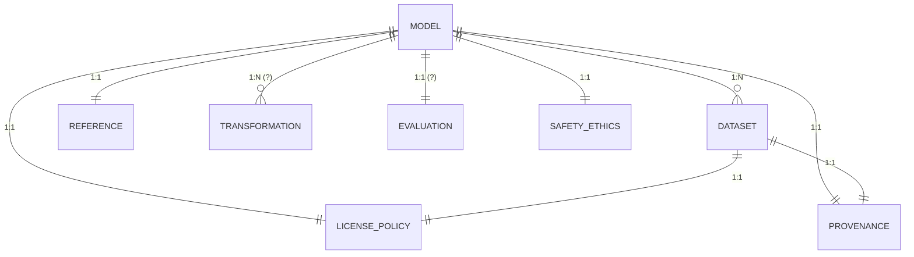
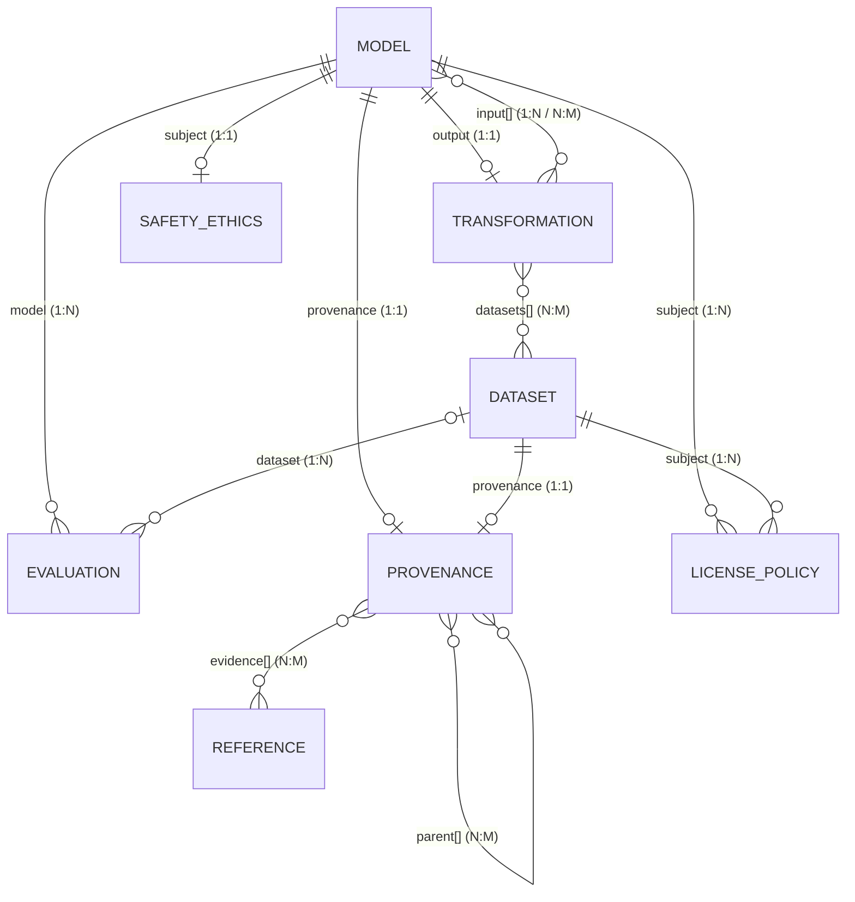

# AIBOM 엔터티 관계도

> `AIBOM_스키마_설계안.md`의 8개 핵심 영역 간 관계(카디널리티)를 정리한 문서.
> 1절은 손으로 그린 초안을 그대로 옮긴 것이고, 3절은 설계안 내용에 맞춰 보정한 버전이다.

## 1. 초안 (손그림 전사)

MODEL을 중심에 두고 각 영역과의 관계를 표현한 초안이다.

| 엔터티 | 메모 | MODEL과의 관계 |
|---|---|---|   
| MODEL | 중심 엔터티 (모델 정보) | – |
| DATASET | 데이터셋 정보 | 1:N |
| REFERENCE | 여러 BOM을 생성했을 때 출처를 포함하기 위한 정보 | 1:1 |
| TRANSFORMATION | based model 정보와 관련 있을까? | 1:N (?) |
| EVALUATION | 모델 평가에 쓴 정보들 | 1:1 (?) |
| SAFETY_ETHICS | 안전 관련 정보 | 1:1 |
| LICENSE_POLICY | 라이선스 관련 정보 | MODEL, DATASET 각각에 대해 1:1 |
| PROVENANCE | 출처 정보들 | MODEL, DATASET 각각에 대해 1:1 |

## 2. 설계안 대조 검토

초안은 MODEL 중심의 별(star) 구조지만, 설계안은 엔터티끼리 서로 참조하는 그래프 구조이다. 여기에 현재 DB 데이터(모델 13개)와 외부 표준(Hugging Face model card, CycloneDX 1.7, SPDX 3.0.1)을 함께 대조했다.

| 관계 | 초안 | 보정 | 근거 |
|---|---|---|---|
| MODEL – TRANSFORMATION (output) | 1:N (?) | **1:1** | 파생 모델 하나에는 변경 기록이 하나이다(`model_hierarchy` PK = `model_id`). 여러 학습 단계(HuatuoGPT의 SFT→PPO, Llama의 SFT·RS·DPO)는 한 변환 안의 순서 있는 `methods`로 표현한다. |
| MODEL – TRANSFORMATION (input) | 1:N (?) | **1:N**, 병합 포함 시 **N:M** | 부모 하나에 자식이 최대 4개이다(`Llama-3.1-8B-Instruct`). HF `base_model`은 병합 모델을 위해 목록을 허용한다. GPT-4o처럼 base가 아닌 역할(generator, verifier)로 변환에 참여하는 모델도 있다. |
| TRANSFORMATION – DATASET | – | **N:M** | 변환 하나에 학습 데이터셋이 여러 개이다(HuatuoGPT). SPDX `trainedOn`은 일대다이다. |
| MODEL – EVALUATION | 1:1 (?) | **1:N** | Egida-DPO는 ASR 지표 3개, HiTZ는 주 지표와 보조 지표를 보고한다. HF `model-index.results[]`, CycloneDX `performanceMetrics[]`, SPDX `metric 0..*` 모두 배열이다. |
| EVALUATION – MODEL (baseline, evaluator) | – | **N:1** (선택) | "0.322 vs 0.471 on the parent model"처럼 점수가 부모 모델과의 비교로 보고된다. |
| MODEL – DATASET | 1:N | 간접 연결, **N:M** | 학습 데이터는 `TRANSFORMATION.datasets`, 평가 데이터는 `EVALUATION.dataset`을 통해 연결된다. |
| MODEL/DATASET – PROVENANCE | 1:1 | **1:1** (유지) | subject당 provenance 하나를 둔다. 병합 모델은 parent가 여러 개일 수 있어 `parent`는 배열이다. |
| MODEL/DATASET – LICENSE_POLICY | 1:1 | **N:M** | 라이선스 하나를 family 전체가 공유한다. Qwen2.5는 크기별로 라이선스가 다르고("Apache-2.0 for the 7B slice"), `license_reported`는 배열이다. SPDX `hasDeclaredLicense`는 일대다이다. |
| MODEL – SAFETY_ETHICS | 1:1 | **1:1** (각 필드는 항목 목록) | 모델당 한 행이다. SPDX `safetyRiskAssessment`는 0..1이지만, CycloneDX `considerations.*`와 현재 데이터(`known_risk`, `inherited_risks`)는 목록이라서 각 필드를 배열로 둔다. |
| (모든 사실) – REFERENCE | 1:1 | **N:M** | 설계안 §5-3에서 하나의 provenance fact에 근거 두 개가 연결된다. SPDX `hasEvidence`는 일대다이고, HF 평가 결과에는 `source`가 붙는다. |

## 3. 보정 관계도

설계안의 영역 8개를 그대로 테이블 8개로 구현했다. 각 필드는 같은 이름의 컬럼이다. 1:N·N:M 관계는 별도 연결 테이블을 두지 않고, 해당 필드 컬럼(JSON 배열)에 상대 엔터티의 id를 담는다.

### 관계 요약

| From | To | 카디널리티 | 구현 컬럼 | 저장 방식 |
|---|---|---|---|---|
| TRANSFORMATION | MODEL (output) | 1:1 | `transformation.output` | FK + UNIQUE |
| TRANSFORMATION | MODEL (input) | 1:N / N:M | `transformation.input` | JSON `[{model, role, external}]`, multi-valued index |
| TRANSFORMATION | DATASET | N:M | `transformation.datasets` | JSON `[{dataset, role}]`, multi-valued index |
| EVALUATION | MODEL | N:1 | `evaluation.model` | FK |
| EVALUATION | DATASET | N:1 | `evaluation.dataset` | FK |
| SAFETY_ETHICS | MODEL | 1:1 | `safety_ethics.subject` | PK + FK |
| MODEL / DATASET | PROVENANCE | 1:1 | `model.provenance`, `dataset.provenance` | FK |
| PROVENANCE | PROVENANCE (parent) | N:M | `provenance.parent` | JSON `["model:<id>", "dataset:<id>"]`, multi-valued index |
| LICENSE_POLICY | MODEL / DATASET | N:1 | `license_policy.subject` | `model:<id>` / `dataset:<id>`, UNIQUE(subject, license) |
| PROVENANCE | REFERENCE | N:M | `provenance.evidence` | JSON `[reference id]`, multi-valued index |

## 4. 설계 원칙

- **영역 = 테이블, 필드 = 컬럼.** 컬럼명은 설계안 필드명과 같다. 필드 하나에 값이 여러 개이거나 구조가 있으면(예: `architecture`, `modality`) JSON 컬럼 하나로 담는다.
- **N:M은 JSON 배열 + multi-valued index로 처리한다.** 연결 테이블 없이도 "X에서 파생된 모델", "MedQA로 학습한 모델" 같은 역방향 조회가 인덱스로 동작한다. 예: `'<id>' MEMBER OF (input->'$[*].model')`. 대신 JSON 안의 id에는 FK를 걸 수 없어서, 무결성은 적재 스크립트가 검사한다.
- **설계안에 없는 정보는 테이블마다 `extensions` JSON 컬럼 하나에 모은다.** 예: 공개 여부(`disclosure_status`), 비교 대상 모델과 점수, 제목, 확인되지 않은 정보(`unknowns`). 설계 필드와 확장 정보가 섞이지 않는다.
- **모델과 데이터셋이 함께 쓰는 subject는 접두어로 구분한다.** `PROVENANCE.subject/parent`와 `LICENSE_POLICY.subject`는 `model:<id>`, `dataset:<id>` 형식이다.
- **공개되지 않은 정보는 억지로 채우지 않는다.** `extensions.disclosure_status`(disclosed, partially_disclosed, undisclosed)로 빈 곳을 명시한다(설계안 §5-3).

## 5. 구현 위치

| 파일 | 내용 |
|---|---|
| `sql/004_aibom_extended_schema.sql` | 영역 테이블 8개 (`model`, `dataset`, `transformation`, `evaluation`, `provenance`, `safety_ethics`, `license_policy`, `reference`) |
| `sql/005_aibom_views.sql` | 모델별 확인용 view (`v_model_aibom`, `v_model_lineage`, `v_model_evaluation`) |
| `data/aibom_research/*.json` | 모델별 조사 결과 (근거 URL 포함) |
| `data/aibom_research/_datasets_*.json` | 공개 벤치마크 데이터셋 보충 조사 결과 |
| `data/aibom_research/_enrichment.json` | 자동 수집 결과: 근거 자료 해시·공개일, HF 데이터셋 버전·라이선스 |
| `scripts/aibom/enrich_research.py` | `_enrichment.json` 병렬 수집 |
| `scripts/aibom/load_research.py` | 조사 결과를 영역 테이블에 적재 |
| `scripts/aibom/export_model_md.py` | view를 읽어 `docs/aibom-models/`에 모델별 md 생성 |

## 6. 남은 검토 사항

- **`model_hierarchy`와 `transformation.input`의 불일치**: `model_hierarchy`는 `Llama-3.1-8B-Instruct`와 `Qwen2.5-7B-Instruct`를 부모 없는 root로 두고 있다. `transformation.input`과 `provenance.parent`는 각각의 base 모델을 부모로 기록한다. 화면(UI) 트리가 `model_hierarchy`를 쓰고 있어서 기존 테이블은 그대로 두었다.
- **PROVENANCE.parent와 TRANSFORMATION.input의 중복**: 설계안대로 두 필드를 모두 두었다. 적재 스크립트가 `input` 중 role이 base 또는 merge_source인 항목으로 `parent`를 만들어 두 값이 항상 같게 유지한다.
- **relation 통제 어휘**: `model_hierarchy.relationship_type`은 camelCase 자유 표현이고, `provenance.relation`은 정해진 목록을 쓴다.
